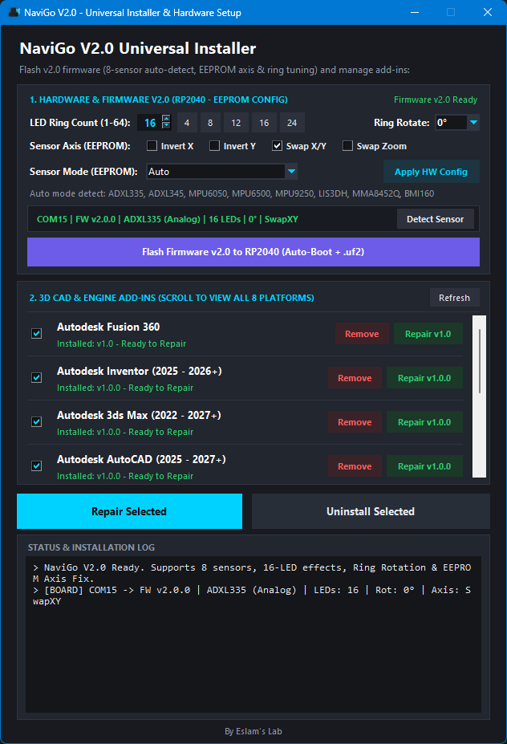

# NaviGo V2.0 — Universal Installer & Hardware Setup Guide

The **NaviGo V2.0 Universal Installer** is an all-in-one desktop utility for Windows and Linux that handles firmware flashing, onboard EEPROM hardware tuning, sensor auto-detection, and native plugin management across all 8 supported 3D/CAD platforms.

---
).

1. **Connect your RP2040-Zero** to your PC via a USB-C data cable.
2. Launch **`NaviGo V2.0 Universal Installer`**.
3. Click the purple **`Flash Firmware v2.0 to RP2040 (Auto-Boot + .uf2)`** button:
   - **If NaviGo firmware is already installed:** The installer automatically triggers bootloader mode (`Auto-Boot`) and flashes the `.uf2` firmware with zero button presses.
   - **If flashing a brand-new RP2040-Zero for the first time:** Hold the physical **`BOOT`** button on the RP2040-Zero while plugging in the USB cable (so the `RPI-RP2` drive appears), then click the flash button.
4. Once complete, the green status bar above the flash button will display your active COM port, firmware version, detected sensor, and saved EEPROM profile (e.g., `COM15 | FW v2.0.0 | ADXL335 (Analog) | 16 LEDs | 0° | SwapXY`).

---

## Step 2: Tuning Hardware & Axis Settings (Onboard EEPROM)

All hardware settings in Section 1 are saved directly to the **RP2040's onboard EEPROM**, meaning your calibration stays stored inside the controller even when you move it between Windows and Linux PCs:

- **LED Ring Count (1–64):** Set the exact number of WS2812B LEDs in your ring using the number box or quick-select presets (`4`, `8`, `12`, `16`, `24`).
- **Ring Rotate (`0°` / `90°` / `180°` / `270°`):** Rotates the directional LED lighting pattern to match the physical orientation of your soldered LED ring.
- **Sensor Axis (EEPROM):**
  - **`Invert X` / `Invert Y`:** Reverses left/right or forward/backward tilt direction if your sensor is mounted upside-down or rotated.
  - **`Swap X/Y`:** Swaps the X and Y tilt axes (useful depending on how your sensor board pins face inside the housing).
  - **`Swap Zoom`:** Reverses the top/bottom side touch zoom buttons (Zoom In ↔ Zoom Out).
- **Sensor Mode (EEPROM):** Leave on **`Auto`** (recommended) to automatically detect all 8 supported accelerometers on boot (`ADXL335`, `ADXL345`, `MPU6050`, `MPU6500`, `MPU9250`, `LIS3DH`, `MMA8452Q`, `BMI160`), or lock a specific sensor manually from the dropdown.
- **Applying & Verifying:**
  - Click **`Apply HW Config`** to write your changes permanently to the board's EEPROM.
  - Click **`Detect Sensor`** at any time to re-query the board and confirm your live sensor and EEPROM settings in the status bar and log window.

---

## Step 3: Installing Native 3D CAD & Engine Add-ins

Section 2 lists all **8 natively supported platforms** (scroll inside the list box to view all 8: **Fusion 360, Inventor, 3ds Max, AutoCAD, Blender, FreeCAD, Maya, and Unity**):

1. Make sure your target CAD/3D software is **closed** before installing or updating its plugin.
2. **Batch Install / Repair:** Check the boxes next to the applications you use and click the blue **`Install Selected`** / **`Repair Selected`** button at the bottom.
3. **Single-App Control:** Use the individual **`Install` / `Repair`** or **`Remove`** buttons on each row to manage plugins one by one.
4. Click **`Refresh`** in the top-right corner of Section 2 to re-scan your system for newly installed CAD versions.

---

## Step 4: Reading the Status & Installation Log

The bottom **`STATUS & INSTALLATION LOG`** console gives real-time feedback:
- **`[BOARD] COMx -> FW v2.0.0 | ...`:** Confirms successful serial communication with the NaviGo controller and displays its active sensor and axis configuration.
- **Add-in Paths & Confirmation:** Displays the exact plugin directory installed or updated for each CAD/3D application.

> **Troubleshooting Tip:** If the board is not detected after flashing, click **`Detect Sensor`**, unplug and reconnect the USB-C cable, or ensure no 3D application is currently holding the COM port open.
